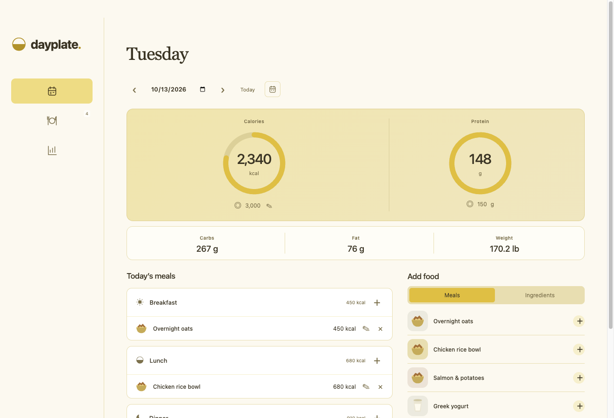
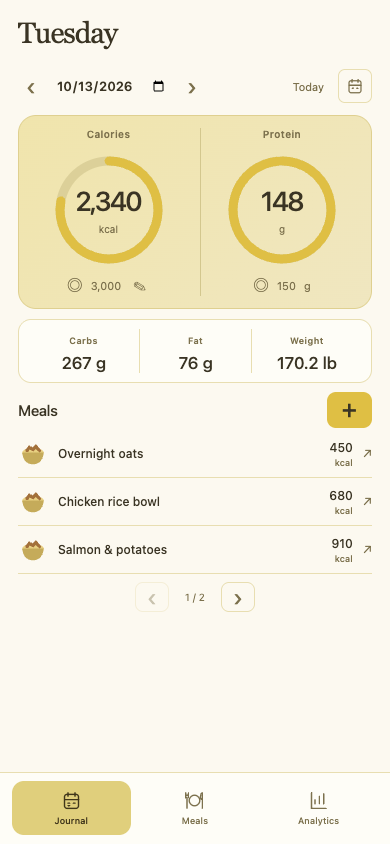
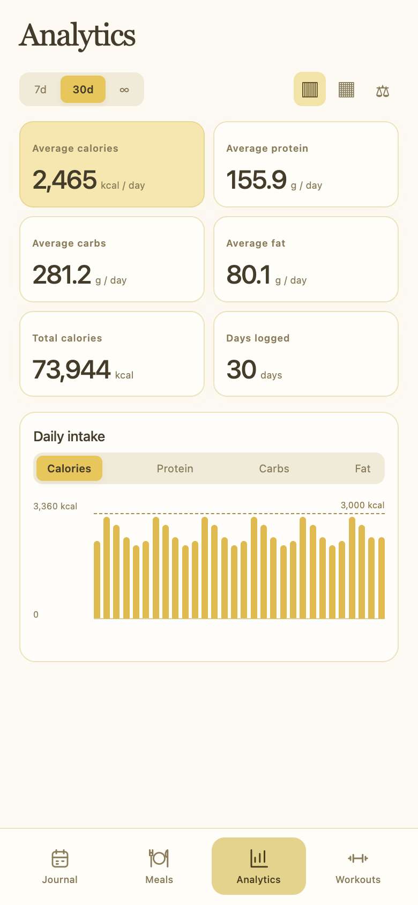
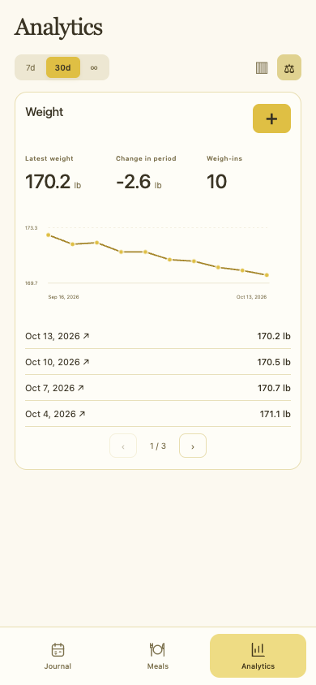
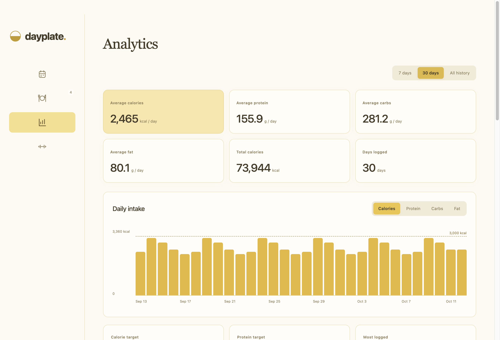

# Dayplate

A local food and weight journal for Mac and iPhone. Warm colors, yellow circular nutrition charts, and compact phone screens.



<p>
  
  
  
</p>

*Screenshots use fictional demo data.*

## Features

- Yellow calorie and protein progress rings with editable daily targets; carbs and fat totals.
- Saved recipes, ingredients, fractional portions, and dated meal logs.
- Nutrition averages, total history, target counts, and daily charts across 7 days, 30 days, or all history.
- Weight trends in lb or kg, with editable weigh-ins.
- Compact phone tabs and paginated lists; animated charts and transitions with reduced-motion support.
- Offline storage, a CLI, and saved recipe snapshots that preserve past logs.

## Run on Mac

Install Node.js and npm, then:

```sh
npm ci
npm start
```

Build a Mac application with `npm run package`. The app appears in `dist/`.

## Build for iPhone

Requires macOS, Xcode, an Apple development account, and an iPhone with Developer Mode enabled.

1. Open `ios/Dayplate.xcodeproj` in Xcode.
2. In Signing & Capabilities, choose your own development team and a unique bundle identifier.
3. Select your connected iPhone and run the Dayplate scheme.

The native app loads the same UI in a WKWebView and stores its journal in the app's Documents directory. The Xcode project can also be regenerated from `ios/project.yml` using XcodeGen; change its signing settings to your own first. Personal-team installations need periodic re-signing.

## Data

No account, server, telemetry, or automatic sync. Mac and iPhone keep independent journals. The Mac journal lives in `~/Library/Application Support/dayplate/journal.json`; the iPhone journal is available through Finder file sharing.

The Mac app migrates older browser storage on first launch. The CLI and Mac app share revision-checked, atomic storage with a previous-version backup. Open the desktop app once before using the CLI with an existing installation.

Nutrition values in the starter library are editable estimates. Missing macros remain unknown. Analytics averages use logged days; each macro uses days with complete values. Recipe edits affect future entries; past entries retain their snapshots.

Private journals, backups, and optional iOS import seeds are excluded from this repository.

## CLI

```sh
node cli.cjs help
node cli.cjs day --date 2026-10-01
node cli.cjs list
node cli.cjs apply --file changes.json --dry-run
node cli.cjs apply --file changes.json
```

See [CLI operations and examples](docs/cli.md) for food, recipe, workout, weight, and journal updates. Inspect a day before logging, use stable IDs for retries, and validate batches with `--dry-run`.

## Development

```sh
npm test
npm run test:ui
npm run screenshots
```

Tests and screenshot generation use isolated temporary journals. Screenshots cover both desktop and populated phone layouts.


